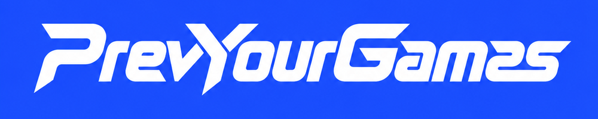
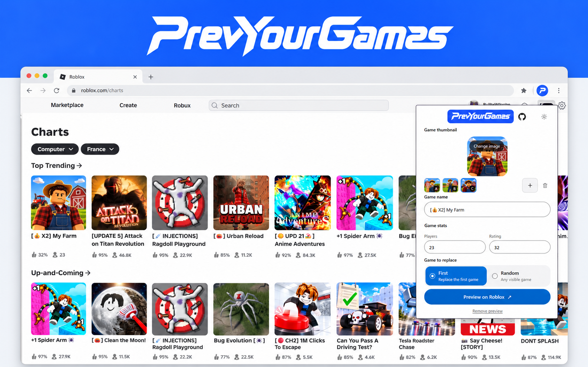

# PrevYourGames

[Extension link: WAITING FOR APPROVAL]



Preview how a Roblox experience thumbnail and name look in Roblox Home or Charts before publishing. PrevYourGames temporarily replaces a visible game card in your active Roblox tab, so you can judge the crop and fit in context. It does not publish anything or change Roblox rankings.



## Features

- Preview an image and experience name on Roblox Home or Charts.
- Replace the first game in the primary section or choose a visible game at random.
- Adjust the horizontal crop position while preserving your original image.
- Update or remove the preview, and switch between light and dark themes.
- Keep preferences and the image in your browser; no user data is sent to a server.

## Install locally in Chrome

1. Download and extract the `PrevYourGames-dist.zip` asset from the [Releases page](https://github.com/mathis1M/PrevYourGames/releases), or build it locally using the development steps below.
2. Open `chrome://extensions` in Chrome and turn on **Developer mode**.
3. Click **Load unpacked** and select the extracted `dist` folder (or the project's `dist` folder after building).
4. Open Roblox Home or Charts, then click the PrevYourGames extension icon.

## Development

You need [Bun](https://bun.sh/) and Chrome.

```sh
bun install
bun run build
```

The unpacked extension is generated in `dist/`. Load that folder in Chrome using the steps above. To check TypeScript types, run `bun run typecheck`; to run the test suite, run `bun test`.

Every push to `main` builds the extension and creates a prerelease containing `PrevYourGames-dist.zip`. The archive contains the ready-to-load `dist` files.
